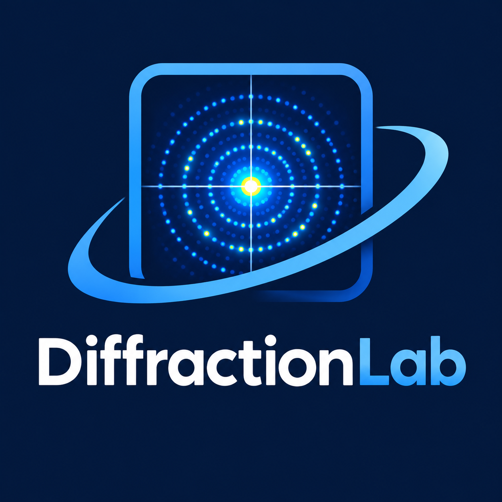
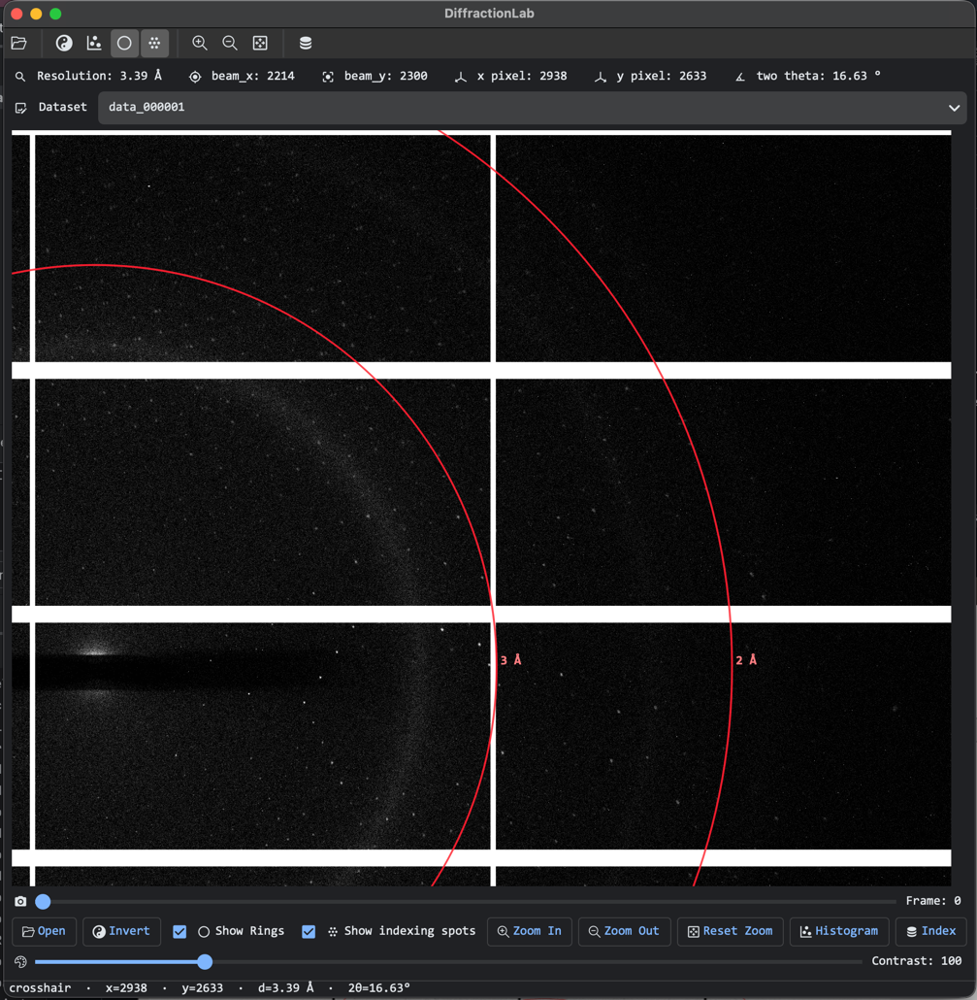

# DiffractionLab



**Interactive X-ray diffraction imaging, indexing, and processing with Python and Qt**

DiffractionLab is a PySide6 desktop application for inspecting crystallographic diffraction images and running interactive indexing workflows. It combines the classic **MOSFLM DPS** indexing workflow with **DIALS** processing for HDF5 / NeXus datasets.

The repository contains:

- **DiffractionLab** — a PySide6 diffraction-image viewer and indexer, currently implemented under `imosflm/`.
- **Legacy iMosflm Tcl sources** — retained under `src/` as reference / legacy UI code.



## Features

### Diffraction-image viewer

- Load and display **CBF**, **HDF5 / NeXus**, **TIFF**, and common raster formats such as **JPEG** and **PNG**.
- Navigate multi-image datasets with a frame slider.
- Zoom and pan using the mouse, toolbar, View menu, and keyboard shortcuts.
- Adjust contrast and inspect the intensity histogram.
- Display resolution rings calculated from beam centre, detector distance, and wavelength.
- View live readouts for resolution, beam coordinates, pixel coordinates, and two-theta.
- Overlay found spots and indexed predictions on the currently displayed frame.

### Indexing with MOSFLM

For CBF and other formats supported by MOSFLM, the Index window provides an iMosflm-style workflow:

1. Find spots over the selected frame range.
2. Run MOSFLM `autoindex dps`.
3. Inspect indexing solutions.
4. Refine the unit cell and estimate mosaicity.

### Indexing and processing with DIALS (HDF5 → MTZ)

When an HDF5 / NeXus master is opened, the Index window becomes a DIALS processing panel:

1. **Import and find spots** — `dials.import` and `dials.find_spots` on a contiguous image wedge.
2. **Index and refine** — `dials.index` (`fft3d`) with automatic refine.
3. **Integrate and export** — `dials.integrate` (with `scan_range`) and `dials.export` → MTZ.

The panel also exposes work-directory browse/reveal, DIALS settings (`nproc`, `d_min`, gain, min spot size, optional known symmetry), a pipeline checklist, **Run full pipeline → MTZ**, progress/log access, and post-MTZ actions (Reveal, Copy path, **Open in Reflection Viewer** via ElMo).

Working files default to `~/.qtmosflm/dials/<dataset_stem>/`. Spot/prediction overlays update with the frame slider.

See [imosflm/README.md](imosflm/README.md) for the full Index UI reference, and the [DIALS processing-in-detail tutorial](https://dials.github.io/documentation/tutorials/processing_in_detail_betalactamase_dui.html).

## Requirements

- Python 3.9+
- PySide6
- NumPy
- h5py
- fabio
- Matplotlib
- Pillow
- OpenCV (`cv2`)

Optional dependencies:

- `pycbf` for enhanced CBF handling.
- [PicoUI](https://github.com/markxbrooks) (`picoui`) for themed toolbar icons.

### External crystallography tools

| Task | Tool | Notes |
|---|---|---|
| MOSFLM DPS indexing | **MOSFLM** (CCP4) | Used for supported non-HDF5 datasets |
| HDF5 / NeXus spot finding, indexing, and integration | **DIALS** (CCP4 or standalone) | Used for Eiger and other compatible HDF5 / NeXus datasets |

DiffractionLab searches for DIALS commands on `PATH`, under `$DIALS_DIR` or `$CCP4`, and in common CCP4 installation prefixes (for example, `/Applications/ccp4-9`). Spot / prediction overlay export may use CCP4's Python when DIALS cannot be imported in the active virtual environment.

Ensure that CCP4 or a standalone DIALS installation is available in your shell when using indexing or HDF5 processing.

## Installation

Clone the repository and install the Python dependencies:

```sh
git clone https://github.com/markxbrooks/pymosflm.git
cd pymosflm

pip install numpy h5py fabio matplotlib pillow opencv-python-headless PySide6
```

The repository URL and directory above retain the current `pymosflm` name. Update them if the GitHub repository is renamed.

If you use CCP4, source its environment before launching the application. For example, on macOS:

```sh
source /Applications/ccp4-9/bin/ccp4.setup-sh
```

## Usage

From the repository root, run:

```sh
python imosflm/qtmosflm.py
```

Optional command-line flags:

| Flag | Purpose |
|---|---|
| `--debug` / `-d` | Write a detailed debug log under `~/.qtmosflm/logs/` |
| `--expert` / `-e` | Enable advanced detector settings |
| `--fastload` / `-f` | Enable experimental faster offline multi-image loading |
| `--version` / `-v` | Print version information |

### Typical workflow

1. Open a diffraction image or an HDF5 / NeXus master.
2. Adjust contrast and zoom; optionally enable resolution rings.
3. Open **Index…** from the toolbar or Process menu (or press `Ctrl+I`).
4. Run the available indexing workflow:
   - **CBF and other MOSFLM-supported images:** find spots and run MOSFLM DPS autoindexing.
   - **HDF5 / NeXus masters:** find spots with DIALS, index and refine, then optionally integrate and export to MTZ.
5. Enable **Show indexing spots** to overlay found spots and predictions. For multi-image datasets, move the frame slider to inspect the overlay on each frame.

## Package layout

The current application code remains under `imosflm/`:

| Module | Role |
|---|---|
| `qtmosflm.py` | Main window and image viewer entry point |
| `image_canvas.py` | Zoomable diffraction canvas and overlays |
| `indexing_dialog.py` | Indexing UI for MOSFLM and DIALS |
| `dials_engine.py` | DIALS subprocess pipeline and `.npz` caches |
| `mosflm_client.py` | MOSFLM process I/O |
| `spotfile.py` | MOSFLM spot-file I/O and peak finding |
| `indexing.py` | Geometry helpers shared by indexing workflows |
| `src/` | Classic iMosflm Tcl sources retained for reference |

## Roadmap

- Improve HDF5 frame loading and caching performance.
- Expand DIALS settings, including gain, `d_min`, and space-group / unit-cell constraints.
- Add deeper MOSFLM session and strategy integration.
- Improve alignment with CCP4i2 and established crystallographic processing pipelines.

DiffractionLab is under active development. Contributions, bug reports, and feature requests are welcome.

## Contributing

Please submit issues or pull requests for bug fixes, improvements, and new features.

## License

Released under the MIT License. See [`LICENSE`](LICENSE).
